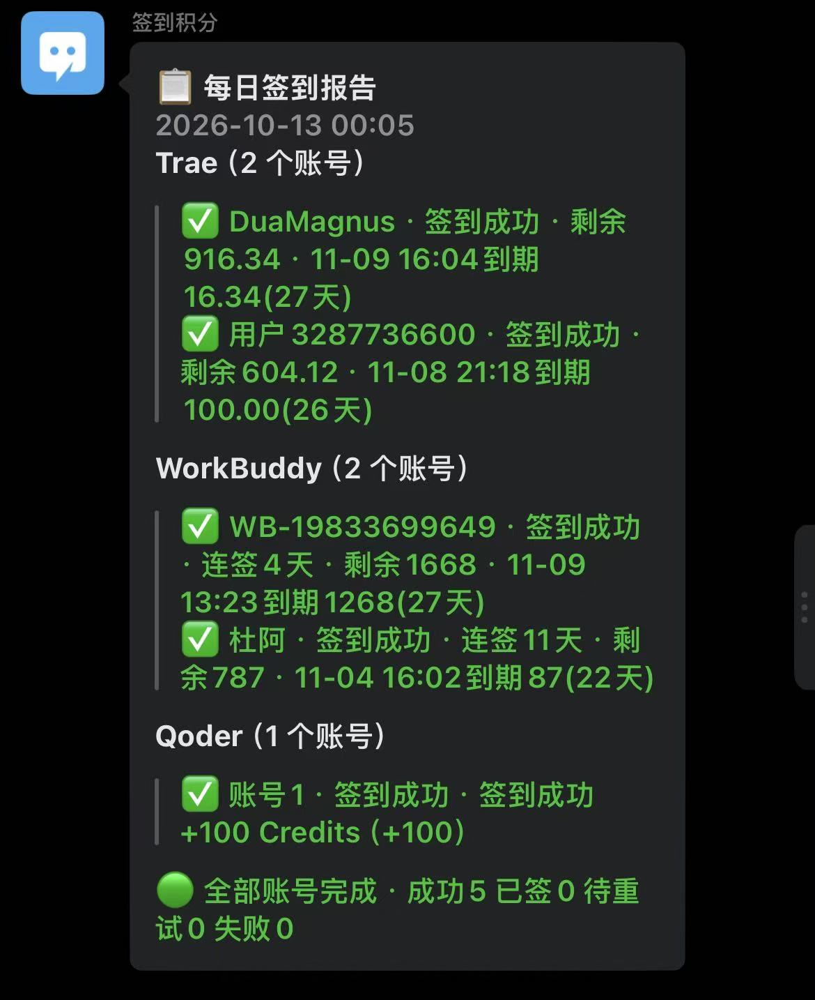

# 🤖✨ 签到管家 · CheckinButler

> 🎯 **一句话介绍**：WorkBuddy + Trae + Qoder 三个平台的每日签到，全自动搞定，结果直接推到你微信群里！
>
> 🧰 **纯 Python 标准库** · 零第三方依赖 🚫📦 · 任意 Windows 电脑拷过去就能跑 💨

---

## ⚠️🐍 开始之前：本程序需要 Python 环境！

> 📖 **新机器请先看根目录的《`README-FIRST.txt`》**（双击就能打开），
> 装好 Python 再双击 `cli.bat`，一分钟都不用多绕。
>
> 🛟 忘了装环境直接点 `cli.bat` 也不会懵——它会**自动弹出安装教程 + 打开 Python 下载页**，
> 照着装完回来再点一次就行 🔄

---

## 🌟 它能帮你做什么？

| 能力 | 说明 |
|---|---|
| 🏢 **WorkBuddy 签到** | 多账号 API 签到，支持国内区，连签天数 / 总积分全记录 |
| 🚀 **Trae 签到** | 多账号 API 签到，自带客户端凭证自动解密 |
| 🧩 **Qoder 签到** | 多账号每天白嫖 100 Credits 💰（本机客户端一键提取凭证） |
| 📨 **企业微信日报** | 三平台结果合并成一条漂亮的消息，绑定当场试发验证 ✅ |
| 🔔 **PushPlus 推送** | 没有企业微信？这个也行，二选一或都配 |
| ⏰ **定时任务全自动** | CLI 里输个时间，计划任务自动创建，从此人畜无害躺平 😴 |
| 🛡️ **当日防重复** | 今天签完了就不再骚扰接口；中途加新号会自动识别照常执行 🧠 |
| 💎 **积分到期提醒** | 日报里带每个账号的剩余积分、最近到期时间、到期积分数，快过期的积分一目了然 👀 |

---

## 📬 日报长这样？

每天早上，群里会准时弹出这么一条消息——谁签了、剩多少积分、哪笔快到期，全都在 👇

<div align="center">



_↑ 真实推送效果：三平台 5 账号一次跑完，积分与到期时间直接看_

</div>

---

## 🚀 快速开始（只需要记住一个动作）

### 👉 双击 `cli.bat`，然后跟着提示走！

> 🐍 前提：电脑装了 Python 3.8+（没装？看根目录 `README-FIRST.txt`，5 分钟搞定）

```
🎉 首次运行 → 自动进入五步向导：

   【1/5】🔍 环境自检        —— Python、网络、脚本全部查一遍
   【2/5】📨 绑定企业微信    —— 粘贴 webhook，当场试发，群里弹出来才算赢！
   【3/5】👥 添加账号        —— 三平台任选，想加几个加几个
   【4/5】⏰ 定时任务        —— 输入每天执行时间（如 09:00），自动创建
   【5/5】🏃 试跑一次        —— 收到日报 = 全部搞定 ✅
```

### 😎 之后每天的世界线

```
09:00 ⏰ 计划任务悄悄启动
09:00 🤖 五个账号依次签到
09:01 📨 群里弹出日报：谁签了、剩多少积分、哪笔快到期
09:01 😴 你继续睡觉/摸鱼，啥也不用管
```

日常想改点什么？重新双击 `cli.bat`，数字菜单伺候 🎛️：

```
[1] 🔍 环境自检          [6] ⏰ 定时任务管理
[2] 🏢 加 WorkBuddy 号   [7] 🏃 立即签到一次
[3] 🚀 加 Trae 号        [8] 💎 积分总览
[4] 🧩 加 Qoder 号       [9] 📜 查看日志
[5] 📨 绑定推送          [0] 👋 退出
```

---

## 📁 目录结构（剧透版）

```
checkin-tool/
├─ 🎮 cli.bat                  ⭐ 控制台入口（双击即用！向导 + 菜单）
├─ 🧠 cli.py                   控制台主程序
├─ 📦 打包.bat                 一键打出可分享的 zip（自动排除凭证/日志）
├─ 🏃 run_checkin.bat          签到主入口（定时任务调它）
├─ 🏢 wb_login.bat             加 WorkBuddy 号（菜单 2 的底层）
├─ 🚀 trae_add.bat             加 Trae 号（菜单 3 的底层）
├─ 🔧 get_tokens.bat           Trae 凭证手动提取（备用路线）
├─ 🧩 qoder_add.bat            加 Qoder 号（菜单 4 的底层）
├─ 🛠️ setup.bat               一键初始化（用 cli.bat 向导可代替）
├─ ⚙️ config/
│   ├─ checkin_env.example.bat     配置模板（脱敏 ✨）
│   └─ trae-accounts/              Trae 账号归档
├─ 🧬 scripts/
│   ├─ cli.py / doctor.py / make_package.py   控制台三件套
│   ├─ run_all.py                  总编排：签到→汇总→推送→当日闸门
│   ├─ Trae-AutoCheckin/           🚀 Trae 签到核心
│   ├─ workbuddy-checkin/          🏢 WorkBuddy 签到核心（auths\ 存凭证）
│   └─ Qoder-Checkin/              🧩 Qoder 签到核心（accounts.json 存凭证）
├─ 📚 docs/                    五篇教程（从 01 开始按顺序读）
└─ 📜 logs/                    运行日志（菜单 9 直接看）
```

---

## 📚 文档索引

| 文档 | 内容 |
|---|---|
| 🏁 [01-快速上手](docs/01-快速上手.md) | 控制台向导逐步说明 + 不用 CLI 的手动路线 |
| 👥 [02-账号管理](docs/02-账号管理.md) | 三平台加号、换号、删号、凭证刷新 |
| ⏰ [03-定时任务](docs/03-定时任务.md) | CLI 自动创建 / 手动配置计划任务 |
| 📨 [04-通知配置](docs/04-通知配置.md) | 企业微信消息推送(群机器人) / PushPlus 获取与填写 |
| 🩹 [05-故障排查](docs/05-故障排查.md) | 常见报错与真实踩坑案例（血泪史 💔） |

---

## 🔐 安全须知（认真脸 😤）

- ⚠️ 这些文件含登录凭证 / 设备标识，**绝对不要提交 git、不要发给任何人**：
  - `config\checkin_env.bat`（推送密钥）
  - `scripts\workbuddy-checkin\auths\*.json`（WorkBuddy 凭证）
  - `config\trae-accounts\*.json`（Trae 凭证）
  - `scripts\Qoder-Checkin\accounts.json`、`config.json`（Qoder 凭证）
- 📨 日报只推送签到状态与积分数，**不含任何凭证**
- 🔄 WorkBuddy accessToken 约 30 天到期，refreshToken 自动续期；真失效了用 CLI 菜单 2 重新授权即可
- ♻️ Qoder token 到期前 72 小时自动刷新，长期免维护

---

## 👤 作者

**Dua** 🧑‍💻

- 🔗 主页 / 更多项目：[duasweb.xyz](https://duasweb.xyz)

---

## ☕ 请作者喝杯奶茶

如果这个小工具帮你省下了每天签到的功夫、攒下了白嫖的积分，不妨请作者喝杯奶茶 🧋
你的每一份支持，都是我继续维护和更新的动力 💪✨

<div align="center">


**支付宝扫码赞赏** · 金额随意，心意最重 ❤️

</div>

> 🙏 当然，白嫖也完全没问题！点个 ⭐ Star 就是最好的鼓励～

---

<div align="center">

🥳 **从此签到这件事，交给机器人就好** 🥳

⭐ 觉得好用就点个 Star 吧 😉

</div>
